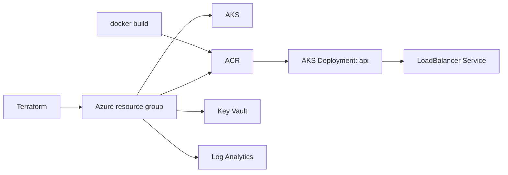
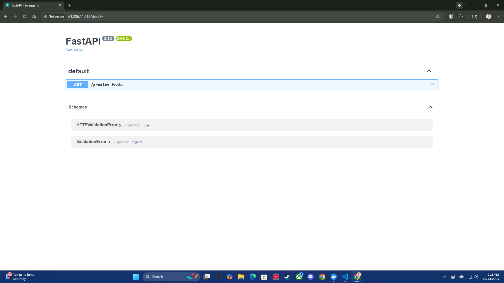
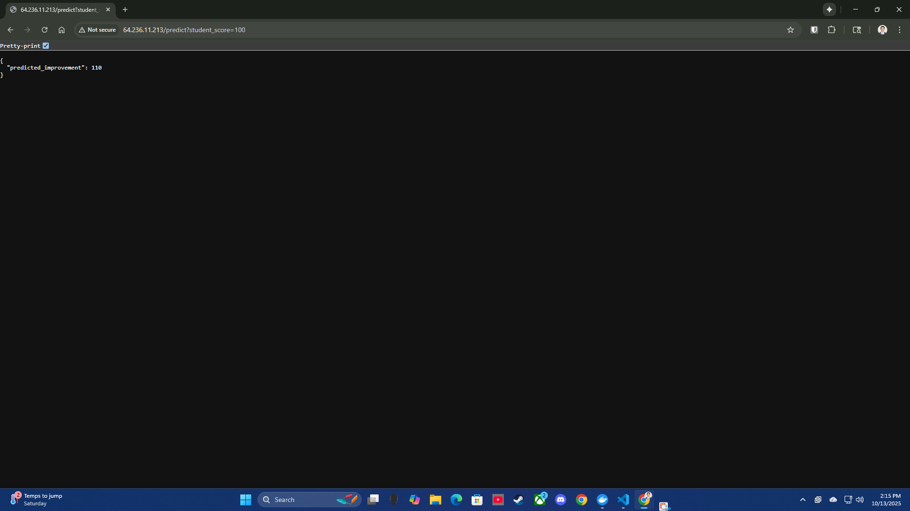
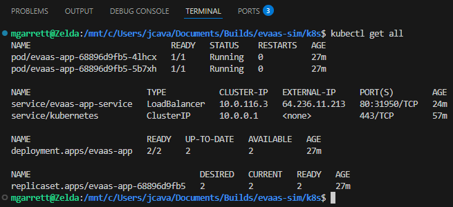
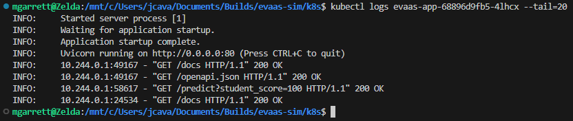
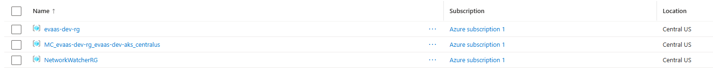
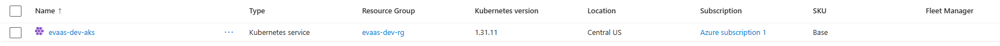
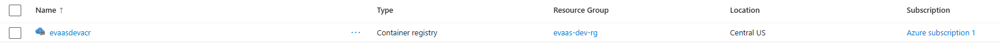

# AKS Terraform Platform

A reference deployment of a containerized Python (FastAPI) service on Azure
Kubernetes Service. Terraform provisions the Azure resources (resource group,
AKS, Container Registry, Key Vault, Log Analytics), and plain Kubernetes
manifests run the service behind a LoadBalancer. It is meant as a small,
hands-on example of deploying a container to AKS with infrastructure as code.

## What's included

- **Terraform** (`infra/`)
  - Resource group
  - AKS cluster (kubenet, RBAC, system-assigned identity, optional autoscaling)
  - Azure Container Registry, with an `AcrPull` role assignment for the AKS kubelet identity
  - Key Vault with access policies and one sample secret generated by `random_password`
  - Log Analytics workspace connected to AKS Container Insights
  - Network security group
  - Outputs for kubectl and ACR login commands
- **Application** (`app/`): a small FastAPI service with `/health` and an
  example `/predict` endpoint, plus a Dockerfile based on `python:3.12-slim`
- **Kubernetes manifests** (`k8s/`): a 2-replica Deployment with liveness and
  readiness probes, and a LoadBalancer Service
- **CI** (`.github/workflows/ci.yml`): pytest, Docker build (no push), and
  `terraform fmt` / `init -backend=false` / `validate`. CI does not deploy.

## Architecture



More detail in [docs/architecture.md](docs/architecture.md).

## Repository layout

```
app/                  FastAPI service, Dockerfile, tests
infra/                Terraform configuration
k8s/                  Kubernetes Deployment and Service
docs/                 Architecture notes, runbook, screenshots
scripts/              Tool install helper (Terraform, kubectl, Azure CLI)
.github/workflows/    CI
```

## Run locally

```bash
cd app
python3.12 -m venv .venv
source .venv/bin/activate
pip install -r requirements-dev.txt
pytest
uvicorn main:app --reload --port 8000
# http://localhost:8000/health
# http://localhost:8000/predict?score=100
# http://localhost:8000/docs
```

With Docker:

```bash
docker build -t api:v1 app
docker run --rm -p 8000:80 api:v1
```

## Deploy to Azure

See [docs/runbook.md](docs/runbook.md) for the full steps: `terraform apply`,
push the image to ACR, then `kubectl apply` the manifests.

## Cost and cleanup

The defaults use a single Standard_B2s node and a Basic ACR to keep costs low,
but the AKS node, load balancer, public IP and Log Analytics are billed while
they exist. Tear everything down when finished:

```bash
kubectl delete -f k8s/
cd infra && terraform destroy
```

## Screenshots

These were captured from an earlier deployment that used the previous `evaas`
naming prefix and an earlier version of the example endpoint.

### API docs


### API response


### Kubernetes resources


### Pod logs


### Azure resource group


### AKS cluster


### Container registry


## Possible next steps

Not implemented yet:

- Ingress controller with TLS
- Prometheus and Grafana for application metrics
- Container image scanning in CI
- Continuous deployment to AKS
- Remote Terraform state backend
