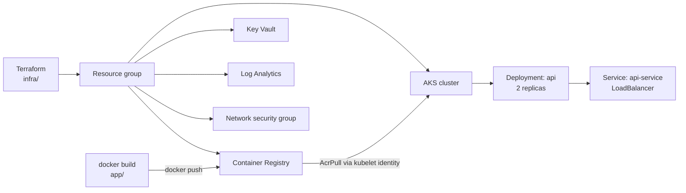

# Architecture

## Overview

This project provisions a small Azure environment with Terraform and runs a
containerized FastAPI service on Azure Kubernetes Service (AKS).

## Flow

Image build, push and `kubectl apply` are manual steps (see the
[runbook](runbook.md)). CI runs tests, a Docker build and Terraform checks, but
does not deploy.

## Infrastructure components

Names below use the default `project_name = "aksplatform"` and
`environment = "dev"`.

- **Resource group**: `aksplatform-dev-rg` (default region: Central US)
- **AKS cluster**: `aksplatform-dev-aks`
  - Kubernetes version: 1.31 (variable)
  - Default node pool: 1 x Standard_B2s (2 vCPU, 4 GB RAM); autoscaling off by default
  - Network plugin: kubenet
  - Kubernetes RBAC enabled
  - Container Insights (OMS agent) connected to Log Analytics when `enable_monitoring = true`
- **Container registry**: `aksplatformdevacr` (Basic SKU). ACR names are
  globally unique, so you may need to change `project_name`.
- **Role assignment**: `AcrPull` for the AKS kubelet identity on the registry
- **Key Vault**: `aksplatform-dev-kv-<random suffix>`, with access policies for
  the deploying user and the AKS kubelet identity, and one sample secret
  (`demo-database-password`) generated by `random_password`
- **Log Analytics workspace**: `aksplatform-dev-logs`, 30-day retention
- **Network security group**: `aksplatform-dev-aks-nsg` allowing inbound 80 and 443.
  It is not attached to a subnet by this configuration.

## Application

- **Framework**: FastAPI (Python 3.12, `python:3.12-slim` base image)
- **Server**: Uvicorn, listening on port 80 in the container
- **Endpoints**:
  - `GET /health` - used by the Kubernetes liveness and readiness probes
  - `GET /predict?score=<int>` - example endpoint returning the score scaled by 1.1
  - `GET /docs` - FastAPI's generated OpenAPI docs

## Security notes

- Kubernetes RBAC enabled
- AKS pulls from ACR using its managed identity (no image pull secrets)
- Sample secret value is generated at apply time, not stored in source. It is
  still present in Terraform state, so the state file needs protecting.
- ACR admin account is enabled by default and Key Vault purge protection is
  off. Both should be changed for production use.

## Cost

- Single B2s node, Basic ACR and 30-day log retention keep costs low.
- The public LoadBalancer Service creates a public IP that is billed while it exists.
- Run `terraform destroy` when you are done.

## Possible next steps

Not implemented in this repository:

- Continuous deployment from GitHub Actions to AKS
- Container image scanning (for example Trivy)
- Ingress controller with TLS instead of a LoadBalancer Service
- Prometheus and Grafana for application metrics
- Remote Terraform state backend
